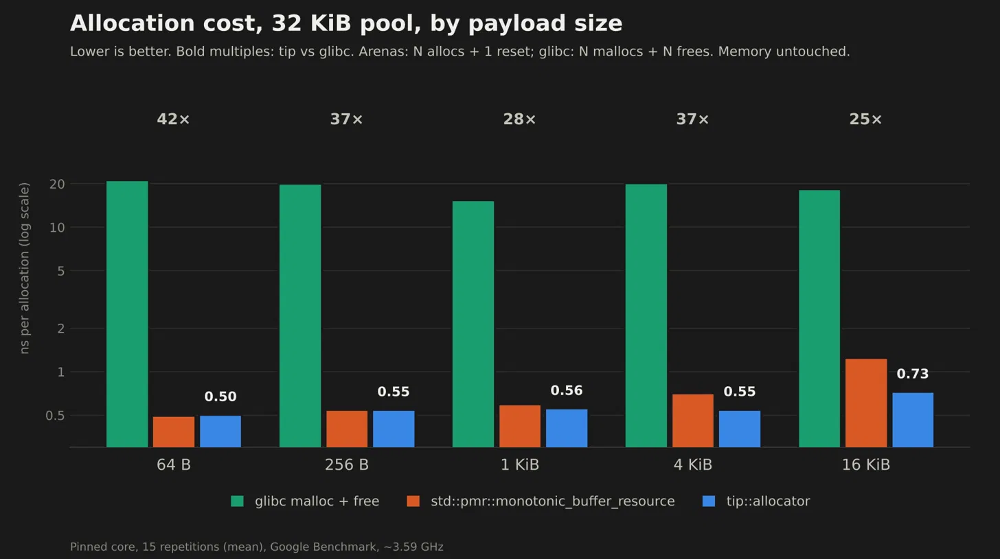
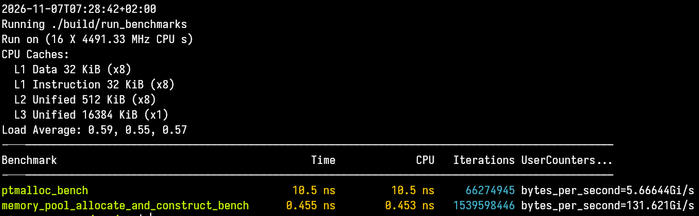

# Tip 

A high performance linear memory allocator written in C++23 

# Performance metrics 

## Benchmarks

A nice bar graph (created by Claude) :




ns per allocation, 32 KiB pool, memory not touched (measures claim cost only, excludes first-touch and construction).

| Payload | glibc malloc + free | `std::pmr` | `tip::allocator` |
|--------:|--------------------:|-----------:|-----------------:|
| 64 B    | 21.16 ns | 0.50 ns | 0.50 ns |
| 256 B   | 20.10 ns | 0.55 ns | 0.55 ns |
| 1 KiB   | 15.41 ns | 0.59 ns | 0.56 ns |
| 4 KiB   | 20.25 ns | 0.71 ns | 0.55 ns |
| 16 KiB  | 18.40 ns | 1.25 ns | 0.73 ns |

**Method:** pinned core, performance governor, locked frequency, 15 repetitions (mean). Per bench iteration : fill the whole pool, then release it. Arenas do N allocations plus one bulk reset; glibc does N mallocs plus N frees. At 64 B and 256 B `tip` and `pmr` are equal within (acceptable) noise. The gap at larger sizes is roughly constant per iteration, likely a cheaper reset rather than a faster allocate(I imagine haven't read the STL implementation **yet**).

## Why use it ?

As a linear allocator tip does minimal work under the hood to allocate and construct an object

The steps are quite literally :

- Align a pointer 
- Decrease the size of the object from the capacity
- Construct the object

This way we achieve things like (tip Vs ptmalloc (single object allocate and construct)) :



A 23x decrease in time is something substancial if your project needs it 

**Note** : Benchmarks for most APIs are still being written

## Requirements 

- CMake version **3.22 and above**
- Ninja **1.13 and above**
- Unix Makefiles **4.0 and above**
- g++ (or any C++ compiler) supporting **C++23**

## Build 

The projects contains a Makefile as well as the CMakeLists.txt file 

If you want to use make : 

```bash
# Generates the build scripts for Ninja
make generator 
# Build the project 
make build 
# Execute the tests
make tests
# Execute the benchmarks
make benchmarks
```

If you **don't** want to use Unix Makefiles :

```bash
# Generate the build scripts for Ninja
cmake -S . -B build -G Ninja -j$(nproc) -DCMAKE_BUILD_TYPE=Release
# Build the project
cmake --build build -j$(nproc)
# Run the tests (100 times each)
ctest --test-dir build --output-on-failure -j$(nproc) --repeat until-fail:100
# Run the tests once per test
ctest --test-dir build --output-on-failure -j$(nproc) 
# Run the benchmarks
./build/run_benchmarks
```

# Contributing 

See **contributing.md**

# Goals 

A simple to use interface with a highly optimised hot path , allowing for rapid reuse 
of allocated space for any demanding workflow that can benefit from using such allocator

## Acknowledgement

As my first "big" project it is obvious that not every decision or implementation is correct or the "best" . If you see something wrong or inefficient you are more than welcome to submit a pull request . Every bit of help is taken into consideration!
